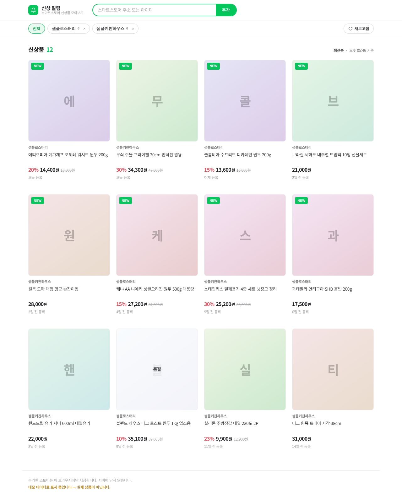
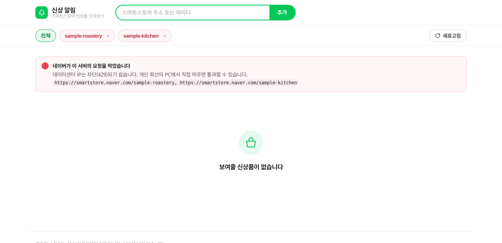

# store-watch-web

`store-watch-core` 위에 얹은 화면입니다. 네이버 스토어의 시각 언어를 참고했습니다.



## 띄우기

```bash
npm install
npm run demo     # 데모 데이터로 화면 확인 (http://localhost:5173)
npm start        # 실제 네이버 조회
```

`npm run demo`는 네이버를 부르지 않고 가상 데이터로 그립니다. 아래 "네이버 차단" 때문에 둔 장치입니다.

## 왜 서버가 있나

브라우저에서 네이버를 직접 부르면 CORS로 막힙니다. 그래서 서버를 한 단계 둡니다.
프레임워크는 쓰지 않았습니다 — 라우트가 둘뿐이고, 코어가 프레임워크에 묶이지 않는다는 성질도 그대로 지킬 수 있습니다.

| 경로 | 하는 일 |
| --- | --- |
| `GET /api/config` | 입력 예시, 기본/최대 개수, 데모 여부 |
| `GET /api/feed?stores=…&limit=…&refresh=1` | 스토어별 조회 → 통합 최신순 목록 |
| 그 외 | `public/` 정적 파일 |

## 코어의 설계 규칙을 어떻게 지켰나

코어 README가 "무너뜨리지 말라"고 적어둔 네 가지에 대한 이 계층의 대응입니다.

1. **SSRF 관문** — 서버는 입력 문자열을 절대 `fetch`에 넘기지 않습니다. `parseStoreInput`을 통과한 `ref`만 아래로 내려갑니다(`server.ts`의 `handleFeed`). 정적 파일도 경로 정규화 후 `public/` 밖이면 거부합니다.
2. **호출 빈도 제한** — `src/rateLimit.ts`. 코어의 `REQUEST_RATE_LIMIT`(60초당 20회)를 IP 단위로 겁니다. 캐시가 비어 실제로 네이버로 나갈 때만 한 번 셉니다.
3. **응답 경로 비의존 파싱** — 서버는 파싱에 손대지 않습니다. 화면은 코어가 정규화한 필드만 읽습니다.
4. **스토어 교차 중복 판단** — 중복 제거와 정렬은 `mergeStoreFeed`가 합니다. 여기서 다시 구현하지 않았습니다.

여기에 하나 더: 코어가 갖지 않는 응답 캐시를 `src/snapshotCache.ts`에 뒀습니다. 수명은 코어의 `UPSTREAM_REVALIDATE_SEC`(300초)와 같습니다. 캐시가 없으면 새로고침할 때마다 네이버를 두드리게 되고, 그게 차단을 앞당깁니다.

## 디자인

네이버 스토어에서 참고한 것: 초록 포인트 컬러, 흰 배경 + 얇은 회색 경계선, 정사각 썸네일 그리드, `할인율(빨강) → 가격(굵게) → 원가(취소선)` 순서의 가격 표기, 좁은 한글 자간.

가져오지 않은 것: 네이버 로고·워드마크·상표. 이 도구는 네이버가 만든 것이 아니고, 그렇게 보이게 만들 이유도 없습니다.

썸네일은 네이버 CDN에서 오는데 차단되거나 사라질 수 있어, 실패하면 상품명 첫 글자를 넣은 면으로 대체합니다(상품번호로 색을 정해 카드마다 다르게 보입니다). 위 스크린샷이 그 상태입니다.

## 실패 화면

네이버가 이 서버를 막으면(`BLOCKED`) 목록 대신 사유를 보여줍니다. 아래는 실제 응답으로 찍은 화면입니다 — 만들어낸 화면이 아닙니다.



## 남은 것

- **네이버 정상 응답 미검증.** 클라우드 IP가 차단(429)돼 성공 경로를 실제 데이터로 확인하지 못했습니다. 개인 회선 PC에서 `npm start`로 띄워 보는 것이 다음 확인입니다.
- **알림 없음.** 지금은 열어봐야 보입니다. 신상품이 뜨면 알려주는 기능은 아직 없습니다.
- **기간 필터 없음.** 코어와 같은 제약입니다. 최신순 정렬만 있고 "최근 N일"은 없습니다.
